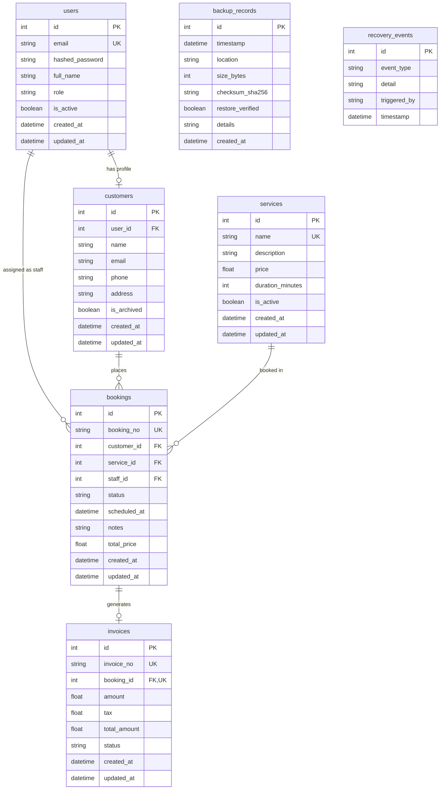

# Project Phoenix: Database Design & Storage Architecture

**Document Version:** 1.0  
**Technology:** SQLite 3.x with Write-Ahead Logging (WAL) Mode  
**Course:** INT333 (DevOps Advanced Configuration Management)  

---

## 1. Storage Engine Architecture & Pragmas

Project Phoenix utilizes SQLite as an embedded, zero-configuration, high-performance database engine. To achieve enterprise reliability and concurrent access without table-level blocking, the engine is initialized with specific runtime pragmas:

| Pragma Directive | Configured Value | Purpose & Architectural Justification |
| :--- | :--- | :--- |
| `PRAGMA foreign_keys` | `ON` | Enforces relational integrity constraints across tables at the SQLite engine level. |
| `PRAGMA journal_mode` | `WAL` | Enables **Write-Ahead Logging**. Allows concurrent read transactions while write operations occur without locking. |
| `PRAGMA synchronous` | `NORMAL` | Ensures full durability for WAL checkpoints while reducing redundant fsync system calls. |
| `PRAGMA busy_timeout` | `5000` | Waits up to 5,000ms for locks to clear before returning `SQLITE_BUSY`. |

---

## 2. Entity-Relationship (ER) Diagram



---

## 3. Detailed Table Schema Definitions

### 3.1 `users`
Stores authenticated principals with role-based access control (RBAC).

| Column | Type | Constraints | Description |
| :--- | :--- | :--- | :--- |
| `id` | INTEGER | PRIMARY KEY AUTOINCREMENT | Unique user identifier |
| `email` | VARCHAR(255) | UNIQUE, NOT NULL, INDEXED | User login identifier |
| `hashed_password`| VARCHAR(255) | NOT NULL | Salted bcrypt password hash |
| `full_name` | VARCHAR(100) | NOT NULL | Display name |
| `role` | VARCHAR(20) | NOT NULL, DEFAULT 'customer'| RBAC role: `'admin'`, `'staff'`, `'customer'` |
| `is_active` | BOOLEAN | NOT NULL, DEFAULT 1 | Account active flag (0 disables login) |
| `created_at` | DATETIME | NOT NULL, UTC | Timestamp of account creation |
| `updated_at` | DATETIME | NOT NULL, UTC | Timestamp of last profile update |

---

### 3.2 `customers`
Stores client demographics and contact information.

| Column | Type | Constraints | Description |
| :--- | :--- | :--- | :--- |
| `id` | INTEGER | PRIMARY KEY AUTOINCREMENT | Unique customer record identifier |
| `user_id` | INTEGER | FOREIGN KEY (`users.id`) ON DELETE SET NULL | Optional linked portal login account |
| `name` | VARCHAR(100) | NOT NULL, INDEXED | Business or individual name |
| `email` | VARCHAR(255) | NOT NULL, INDEXED | Primary contact email |
| `phone` | VARCHAR(50) | NULLABLE | Contact telephone number |
| `address` | VARCHAR(255) | NULLABLE | Physical / billing address |
| `is_archived` | BOOLEAN | NOT NULL, DEFAULT 0 | Soft-deletion flag |
| `created_at` | DATETIME | NOT NULL, UTC | Creation timestamp |
| `updated_at` | DATETIME | NOT NULL, UTC | Last modification timestamp |

---

### 3.3 `services`
Stores catalog offerings provided by the business.

| Column | Type | Constraints | Description |
| :--- | :--- | :--- | :--- |
| `id` | INTEGER | PRIMARY KEY AUTOINCREMENT | Unique service identifier |
| `name` | VARCHAR(100) | UNIQUE, NOT NULL, INDEXED | Service title (e.g., 'DevOps Audit') |
| `description` | VARCHAR(255) | NULLABLE | Service description |
| `price` | FLOAT | NOT NULL | Base cost in USD |
| `duration_minutes`| INTEGER | NOT NULL, DEFAULT 60 | Estimated delivery duration |
| `is_active` | BOOLEAN | NOT NULL, DEFAULT 1 | Active catalog offering flag |
| `created_at` | DATETIME | NOT NULL, UTC | Creation timestamp |
| `updated_at` | DATETIME | NOT NULL, UTC | Last modification timestamp |

---

### 3.4 `bookings`
Core operational entity tracking client appointments, assigned staff, and status transitions.

| Column | Type | Constraints | Description |
| :--- | :--- | :--- | :--- |
| `id` | INTEGER | PRIMARY KEY AUTOINCREMENT | Unique internal ID |
| `booking_no` | VARCHAR(32) | UNIQUE, NOT NULL, INDEXED | Formatted identifier (e.g., `BK-20261116-A1B2`) |
| `customer_id` | INTEGER | FOREIGN KEY (`customers.id`) ON DELETE RESTRICT | Associated customer |
| `service_id` | INTEGER | FOREIGN KEY (`services.id`) ON DELETE RESTRICT | Selected service |
| `staff_id` | INTEGER | FOREIGN KEY (`users.id`) ON DELETE SET NULL | Assigned staff member |
| `status` | VARCHAR(20) | NOT NULL, DEFAULT 'pending' | Status state machine |
| `scheduled_at` | DATETIME | NOT NULL, UTC | Appointment execution timestamp |
| `notes` | TEXT | NULLABLE | Operational requirements / notes |
| `total_price` | FLOAT | NOT NULL | Lock-in price at time of booking |
| `created_at` | DATETIME | NOT NULL, UTC | Creation timestamp |
| `updated_at` | DATETIME | NOT NULL, UTC | Last modification timestamp |

#### Booking Lifecycle State Transitions
```
                ┌──────────────┐
                │   pending    │
                └──────┬───────┘
                       │ Staff confirms
                       ▼
                ┌──────────────┐
     ┌──────────┤  confirmed   ├──────────┐
     │          └──────┬───────┘          │
     │ Staff cancels   │ Service finished │ Customer cancels
     ▼                 ▼                  ▼
┌───────────┐   ┌──────────────┐   ┌───────────┐
│ cancelled │   │  completed   │   │ cancelled │
└───────────┘   └──────┬───────┘   └───────────┘
                       │ Generates Invoice
                       ▼
                ┌──────────────┐
                │   invoiced   │
                └──────────────┘
```

---

### 3.5 `invoices`
Billing records generated strictly against completed bookings.

| Column | Type | Constraints | Description |
| :--- | :--- | :--- | :--- |
| `id` | INTEGER | PRIMARY KEY AUTOINCREMENT | Unique invoice ID |
| `invoice_no` | VARCHAR(32) | UNIQUE, NOT NULL, INDEXED | Formatted identifier (e.g., `INV-20261116-0001`) |
| `booking_id` | INTEGER | FOREIGN KEY (`bookings.id`) UNIQUE, ON DELETE RESTRICT | 1-to-1 linkage to completed booking |
| `amount` | FLOAT | NOT NULL | Subtotal amount |
| `tax` | FLOAT | NOT NULL, DEFAULT 0.0 | Calculated tax |
| `total_amount` | FLOAT | NOT NULL | Total amount payable |
| `status` | VARCHAR(20) | NOT NULL, DEFAULT 'issued' | Invoice status: `'draft'`, `'issued'`, `'paid'`, `'cancelled'` |
| `created_at` | DATETIME | NOT NULL, UTC | Creation timestamp |
| `updated_at` | DATETIME | NOT NULL, UTC | Last modification timestamp |

---

### 3.6 `backup_records`
Audit trail of external snapshot operations for Disaster Recovery compliance.

| Column | Type | Constraints | Description |
| :--- | :--- | :--- | :--- |
| `id` | INTEGER | PRIMARY KEY AUTOINCREMENT | Unique record ID |
| `timestamp` | DATETIME | NOT NULL, INDEXED, UTC | Timestamp snapshot was generated |
| `location` | VARCHAR(500)| NOT NULL | Absolute filesystem or storage URI |
| `size_bytes` | INTEGER | NOT NULL | Exact byte length of snapshot |
| `checksum_sha256` | VARCHAR(64) | NOT NULL | SHA-256 cryptographic digest |
| `restore_verified`| BOOLEAN | NOT NULL, DEFAULT 0 | 1 if snapshot successfully tested via restore |
| `details` | TEXT | NULLABLE | Metadata (e.g. table counts, integrity result)|
| `created_at` | DATETIME | NOT NULL, UTC | Creation timestamp |

---

### 3.7 `recovery_events`
Immutable disaster recovery and incident telemetry ledger.

| Column | Type | Constraints | Description |
| :--- | :--- | :--- | :--- |
| `id` | INTEGER | PRIMARY KEY AUTOINCREMENT | Unique event identifier |
| `event_type` | VARCHAR(50) | NOT NULL, INDEXED | Event category (`SERVICE_FAILURE`, `DATABASE_RESTORE`, `RECOVERY_VERIFIED`, etc.) |
| `detail` | TEXT | NULLABLE | Detailed description, status code, or table census |
| `triggered_by`| VARCHAR(100)| NOT NULL | Actor/Tool (`SIMULATE_FAILURE_SCRIPT`, `ANSIBLE_RECOVER`, `VERIFY_RECOVERY_SCRIPT`) |
| `timestamp` | DATETIME | NOT NULL, INDEXED, UTC | Event occurrence timestamp |

---

## 4. Disaster Recovery Backup & Restore Protocol

### 4.1 Non-Blocking Snapshot Generation
The backup engine (`scripts/backup.py`) utilizes Python's native SQLite Backup API (`sqlite3.Connection.backup()`):
```python
# Atomic hot-backup without locking reader transactions:
source_conn = sqlite3.connect(live_db_path)
dest_conn = sqlite3.connect(backup_path)
source_conn.backup(dest_conn)
dest_conn.close()
source_conn.close()
```

### 4.2 Integrity Verification & Cryptographic Hashing
Before logging a backup as valid:
1. `PRAGMA integrity_check` is executed against the destination file.
2. SHA-256 hash is calculated across the file chunks.
3. Row counts are tabulated across all core tables and stored in `details`.

### 4.3 Atomic Restoration Process
During disaster recovery (`scripts/restore.py`):
1. The backup file is validated: SHA-256 integrity and `PRAGMA integrity_check`.
2. The active database path is replaced atomically (`shutil.copy2`).
3. Relational integrity is confirmed on the target database (`PRAGMA foreign_key_check`).
4. An audit row is inserted into `recovery_events` with `event_type='DATABASE_RESTORE'`.
5. The `backup_records` entry is updated with `restore_verified=True`.
